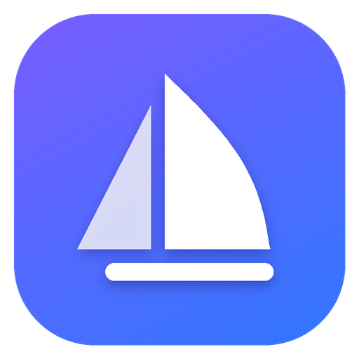
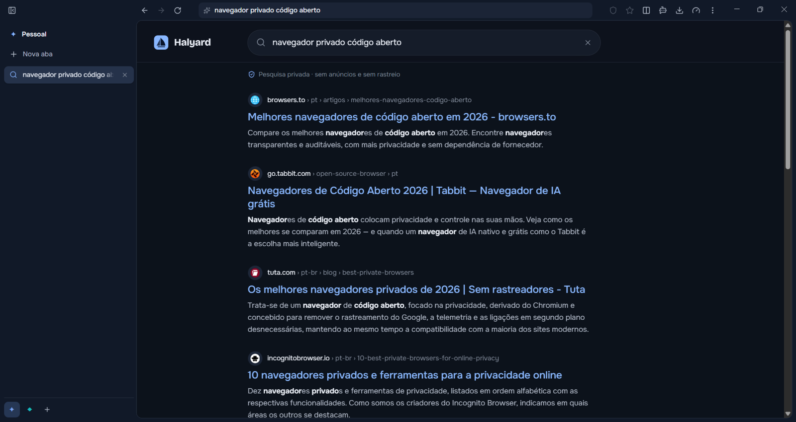
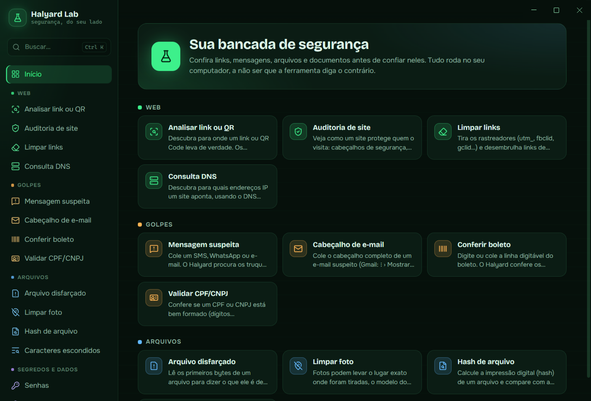
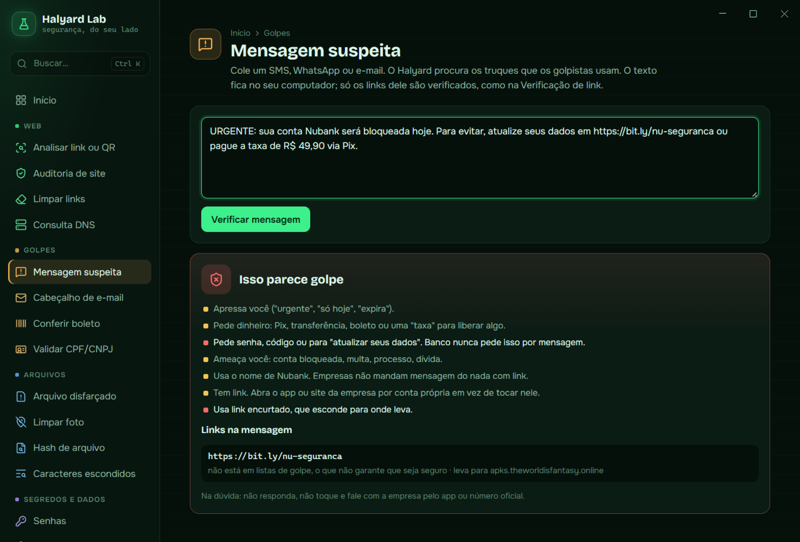
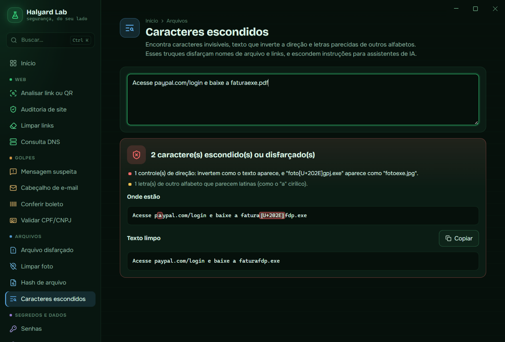
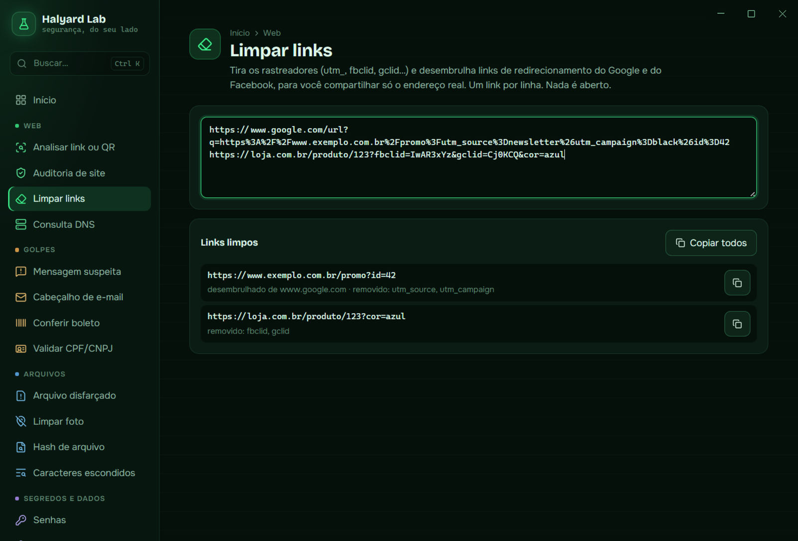
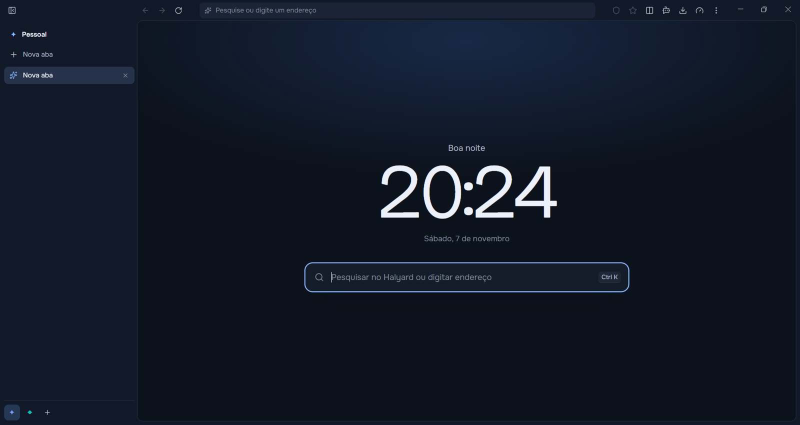

<p align="center">
  
</p>

<h1 align="center">Halyard Browser</h1>

<p align="center">
  Um navegador para Windows rápido, privado e com ferramentas anti-golpe de verdade.<br>
  Grátis e de código aberto.
</p>

<p align="center">
  <a href="https://halyard-browser.vercel.app"><b>Site</b></a> ·
  <a href="https://github.com/reiakashi1v10-dot/halyard-browser/releases/latest"><b>Baixar</b></a> ·
  <a href="#english">English</a>
</p>

<p align="center">
  
</p>

## Por que o Halyard

- **Sem anúncios e sem rastreadores.** Usa as listas do uBlock Origin, atualizadas todo dia.
- **Busca privada própria.** Resultados limpos, sem anúncios e sem histórico guardado.
- **Proteção contra golpe dentro do navegador.** Avisa sobre sites parecidos com bancos e lojas, listas de phishing, senhas vazadas, o golpe do "ClickFix" e páginas que imitam o Windows.
- **Downloads vigiados.** Programas esperam o seu sim e passam pelo Microsoft Defender. Arquivos `.zip` com programas escondidos e nomes como `fatura.pdf.exe` são detectados.
- **Halyard Lab:** uma caixa de ferramentas de segurança, explicada abaixo.

## Halyard Lab

19 ferramentas para conferir antes de confiar. Quase tudo roda no seu computador e nada é enviado, a não ser que a ferramenta avise.

<p align="center">
  
</p>

| Grupo | Ferramentas |
| --- | --- |
| **Golpes** | Mensagem suspeita (SMS, WhatsApp, e-mail) · Cabeçalho de e-mail (SPF, DKIM, DMARC) · Conferir boleto · Validar CPF/CNPJ |
| **Web** | Analisar link ou QR Code · Auditoria de site · Limpar links · Consulta DNS |
| **Arquivos** | Arquivo disfarçado · Limpar foto (tira GPS e dados da câmera) · Hash de arquivo · Caracteres escondidos |
| **Segredos e dados** | Senhas · Cofre de texto (AES-256) · Gerador de tokens · Decodificadores · Gerar QR Code |

<table>
  <tr>
    <td width="50%"><br><sub>Uma mensagem de golpe e o link encurtado, que leva a outro site.</sub></td>
    <td width="50%"><br><sub>Uma letra cirílica em "paypal" e um nome de arquivo invertido.</sub></td>
  </tr>
  <tr>
    <td width="50%"><br><sub>Links sem utm, fbclid e gclid, e sem o redirecionamento do Google.</sub></td>
    <td width="50%"><br><sub>A nova aba.</sub></td>
  </tr>
</table>

## Instalar

Baixe a última versão em **[Releases](https://github.com/reiakashi1v10-dot/halyard-browser/releases/latest)**. Funciona no Windows 10 e 11 (64 bits).

- **`Halyard-Browser-x.y.z-setup.exe`**: instala e se atualiza sozinho.
- **`Halyard-Browser-x.y.z-portable.exe`**: roda sem instalar, por exemplo num pen drive.

> **O Windows mostrou "O Windows protegeu o computador"?**
> O instalador ainda não tem assinatura digital paga, então o SmartScreen avisa. Clique em **Mais informações → Executar assim mesmo**. O código está todo aqui para quem quiser conferir.

## Rodar a partir do código

Precisa do [Node.js](https://nodejs.org) 22 ou mais novo.

```bash
npm install
npm run dev        # abre o Halyard em modo de desenvolvimento
npm run typecheck  # confere os tipos
npm run dist       # gera o instalador e a versão portátil em dist/
```

Feito com Electron, React e TypeScript. O código fica em `src/`:
- `main/`: o navegador em si, com abas, proteções e downloads;
- `renderer/`: as telas;
- `shared/`: tipos e traduções.

## Privacidade

O Halyard não tem telemetria. A conta é opcional e só serve para sincronizar, se você quiser. Detalhes na [política de privacidade](legal/privacidade.md).

## Licença

[MIT](LICENSE). As licenças dos componentes de terceiros estão em [`legal/THIRD_PARTY_NOTICES.txt`](legal/THIRD_PARTY_NOTICES.txt).

---

<h2 id="english">English</h2>

**Halyard** is a free, open-source Windows browser focused on privacy and on stopping scams. It includes:
- ad and tracker blocking (uBlock Origin lists);
- a private search page;
- look-alike site and phishing warnings;
- leaked-password checks;
- download screening with Microsoft Defender.

**Halyard Lab** adds 19 local security tools. They check suspicious messages and links, e-mail headers, disguised files, hidden Unicode characters and photo metadata. They also include a text vault and token and QR generators.

Download it from [Releases](https://github.com/reiakashi1v10-dot/halyard-browser/releases/latest) or the [website](https://halyard-browser.vercel.app). The app is available in English, Portuguese and Spanish. MIT licensed.
